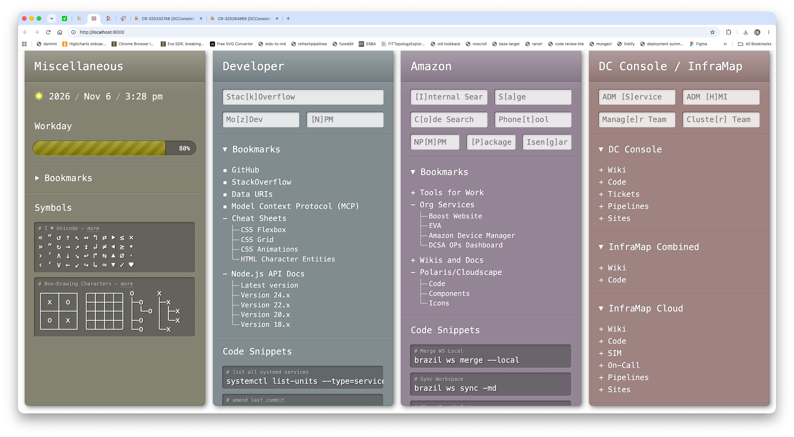
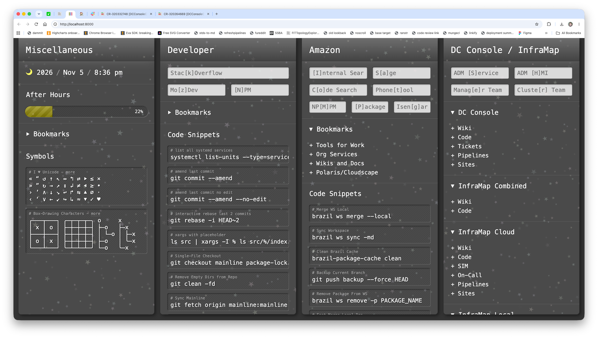

# New layout

This app is largely inspired by its predecessor, which also used
[viewport relative design](./VIEWPORT_RELATIVE_DESIGN.md):



I want to abandon most of the skinnability features in this app, and adopt the look and feel shown
in this screenshot. To help with that, I've included [its CSS](./look-at-this-layout.css).

## Things to note

### The time widget

It's an evolution of the existing time widget. It shows a sun/moon icon plus the date in this
format:

> YYYY / MMM / D / H:SS a

The sun displays between `startOfDay` AND `endOfDay`. The moon between `endOfDay` and `startOfDay`.
These values are part of the user's configuration and have these defaults:

- `startOfDay` — 9:00 AM local time
- `endOfDay` — 5:00 PM local time

These cutoffs are not part of the widget configuration, but part of the user's overall config, since
they affect other parts of the app.

Also, the time widget is included in the default layout. It's still a widget so it can be removed or
moved, it's just part of the default layout a user gets.

### Night mode

Between `endOfDay` and `startOfDay`, the layout transitions to night as seen in this screenshot:



The transition takes 20s.

The starfield overlaying the UI gradually fades into view to emulate nighttime. The element covers
the UI edge to edge/top to bottom, is SVG, is generated randomly, never reaches full opacity, and
styled with `pointer-events: none` so it doesn't hinder use of the UI. The starfield is generated
following these rules:

- No two stars' containing circles overlap.
- Stars are randomly oriented.
- Stars are randomly, subtly tinted.
- The distribution of star _sizes_ is random, following a logarithmic distribution, so there are
  more small stars than large ones.
- A star takes 30s to fully fade in.
- Stars don't all fade in simultaneously, each star gets a predelay. The distribution of predelays
  is random over a 30s window.

### The "workday" widget

This displays a progress bar with a "rolling stripes" animation. It can be in one of 3 states:

- "Workday" — Between 9:00 AM - 5:00 PM on a weekday
- "After Hours" — Between 5:00 PM - 9:00 AM on successive weekdays
- "Weekend" — Between 5:00 PM Friday - 9:00 AM Monday

When transitioning between a state, the progress bar animates.

Note that the position of the percentage indicator is shifted to the left or right so it never
covers the edge of the progress bar.

### Only bookmark widgets have headings and are collapsible

Headings and are collapsibility stop being a universal feature of widgets.

### Monospace font

Everything uses `font-family: monospace`.

### List styles

List styles use box-drawing characters. These are visible in the screenshot. They're added via CSS.

## How does this reconcile with skinnability?

I want to remove most skinnability features. The only styles that remain customizable are column
background colors, and even then, I want to limit how that works. They must be implemented using
[OKLCH colors](https://developer.mozilla.org/en-US/docs/Web/CSS/Reference/Values/color_value/oklch).
For example, the four colors in the screenshot would be:

```
oklch(0.63553 0.0185455 104.283)
oklch(0.63553 0.0110218 222.288)
oklch(0.63553 0.0238316 322.557)
oklch(0.63553 0.0252648 23.606)
```

Colors use this template: `oklch(0.63553 ${c} ${h})`. The user can only adjust the `c` and `h`
components. Foreground color is always white. Colors will transition to `#4a4a4a` in night mode. The
reason for using OKLCH is its perceptual uniformity. Different OKLCH colors desaturate uniformly
toward the same shade of gray.

## How does this reconcile with column heading icons?

We keep that feature. Columns continue to have custom icons.

## How does this reconcile with the admin bar and the column thumbnails?

The columns should still shorten to accommodate these elements, the way they do in the current
layout. They'll still work the way they currently do.

## How does this reconcile with there being less than 3 columns?

We'll still show a dotted outline to create a new column if there are less than 4 columns.
