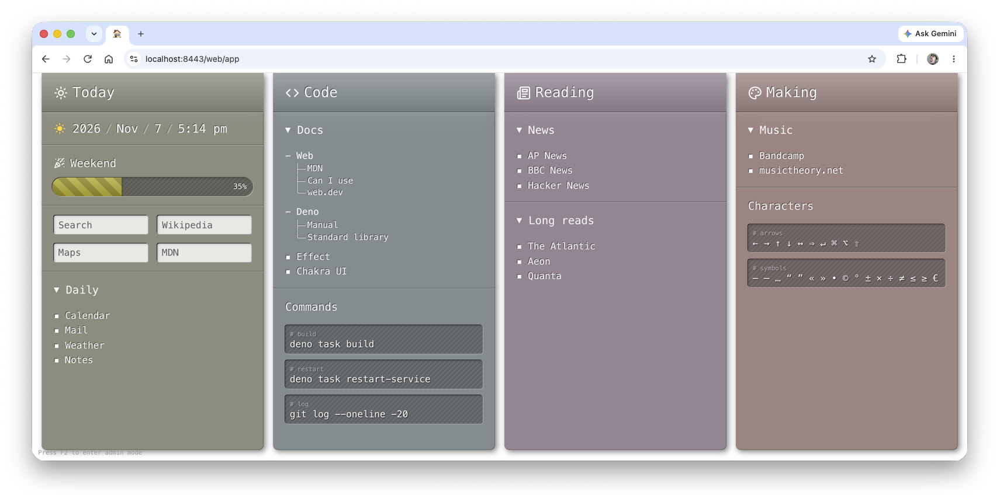
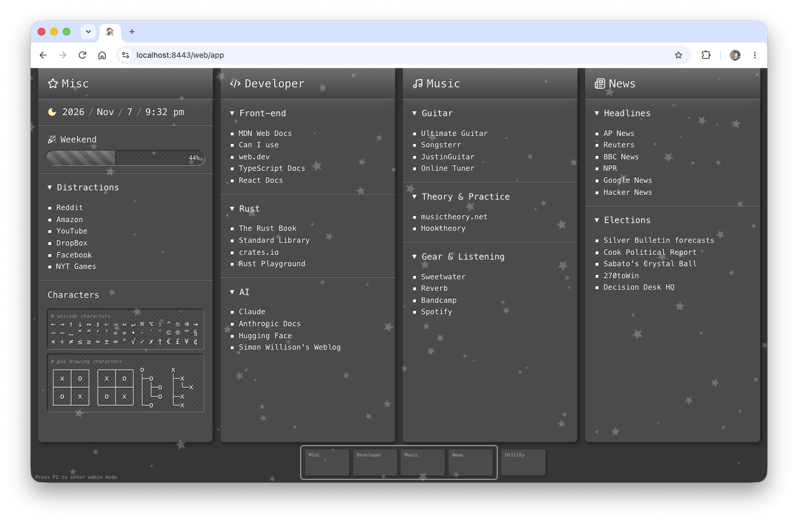

# Your Home Page

A browser home page that you change by talking to [Claude Code](https://code.claude.com/). Ask for a
column of news links and it adds one. Ask for a stock ticker, a feed reader or a map, and if no
widget does that yet, it writes one: new code, in this repo, that you can keep, change and commit.

It runs on your Mac, on localhost over HTTPS, and your layout never leaves your machine.



## What it does

- **Columns of widgets.** Each column has a heading, an icon and a color. The page fills the width
  of the window and scales with it.
- **Widgets that come with it:**
  - **Bookmarks**, with folders.
  - **Search fields** that open a site's search with what you typed.
  - **Copyable snippets**, such as shell commands or special characters.
  - **A clock**.
  - **A workday bar** showing how far you are through your working week.
- **The assistant.** Claude Code, in a window beside the page. It can rearrange the page for you,
  write new kinds of widget, or work on any other part of the code, as it would in a terminal.
- **Night mode.** After your day ends, the page fades to gray and a starfield comes out.



## Requirements

| What                                                   | Why                                                                                                                                         | Get it                                                            |
| ------------------------------------------------------ | ------------------------------------------------------------------------------------------------------------------------------------------- | ----------------------------------------------------------------- |
| **macOS**                                              | The server runs as a launchd service, and its HTTPS certificate is trusted through the login keychain. There's no Linux or Windows support. | —                                                                 |
| **[Deno](https://deno.com/) 2**                        | Runs everything. The server bundles the page at startup with Deno's built-in bundler, so older versions won't do. Known to work with 2.9.   | `brew install deno`, or `deno upgrade`                            |
| **[Claude Code](https://code.claude.com/)**, signed in | The assistant runs Claude Code (bundled with the Agent SDK) and signs in with your Claude Code login.                                       | Install it, then run `claude` once to sign in                     |
| **git**                                                | Getting the code, and for the assistant to commit when you ask it to.                                                                       | Comes with the Xcode command line tools: `xcode-select --install` |
| **openssl** and **security**                           | Making and trusting the certificate.                                                                                                        | Built into macOS                                                  |
| **A current browser**                                  | The page uses recent CSS (e.g. OKLCH colors). Current Chrome and Safari work.                                                               | —                                                                 |
| **Ports 8443 and 9443** free                           | The server and the assistant service listen on them, on 127.0.0.1 only.                                                                     | —                                                                 |

## Setup

```sh
git clone https://github.com/greim/home-page.git
cd home-page
deno task doctor           # what's missing, and how to fix it (fetches dependencies first)
deno task setup-certs      # create & trust a localhost TLS certificate (prompts for approval)
deno task install-service  # start at login, restart automatically if it ever exits
deno task doctor           # everything should now pass
```

Then open and pin <https://localhost:8443/web/app>. It starts with a single column holding a clock;
press **F2** to start making it your own.

`deno task doctor` checks each requirement above, then the certificate (and its expiry), whether
macOS trusts it, and whether both services are running. It prints a fix for anything wrong. Run it
whenever something seems off.

## Using it

- Press **F2** to toggle **admin mode**. The columns look exactly the same, but what you can change
  becomes clickable:
  - Click a column's heading to rename it (Enter saves, Esc cancels).
  - Click its icon to pick another.
  - Click a widget or the column's background to open the **column editor**.
- The **column editor** edits a column's heading and icon, and lists its widgets. Drag them to
  reorder, send them to another column, delete them, add new ones, or select one to edit its
  settings. Changes apply when you click Save.
- The **column navigator** along the bottom is always shown in admin mode:
  - Add columns with the dashed boxes at either end, or the "+" markers between thumbnails.
  - Each thumbnail has icons to move (drag it, or use the arrow keys), delete, and hide its column,
    and to color it. Drag the hue and chroma sliders and the column changes as you go; OK closes
    them. Column colors share one lightness, so white text always reads on them.
- The **admin bar** along the top says how to leave admin mode. At night, its sun button shows the
  page in daytime, so you can see and edit column colors.
- **Bookmarks** are edited as an outline: `Label | URL` per line. A line without a URL is a folder,
  and the indented lines below it are its links.
- **Search field** URLs use `{query}` where what you type goes.
- **Your day** (when night mode starts and ends, and what the workday bar follows) is 9 to 5 until
  you change it. There's no control for it on the page yet: ask the assistant ("my day starts at
  8"), or edit `schedule` in `data/layout.json` while the server is stopped.

## The assistant

The **assistant** button in the admin bar opens Claude Code in a window of its own, floating above
your other windows (in Chrome or Edge; elsewhere, a panel at the side of the page). It's another way
of using Claude Code in this repo, as if you'd typed into it in a terminal:

- It uses your own Claude Code login, settings, permission rules, hooks, MCP servers and skills.
- It can change any code, run commands, and commit when you ask.
- Anything your settings don't already allow, it asks first. You can allow once, always allow, or
  deny, in the chat. Plan mode and accept-edits mode work as in the terminal.
- It sees a screenshot of the page with each message, so you can say "make that column blue".
- You can pick the model, use slash commands, paste images, and continue past conversations,
  including ones you started in a terminal.
- Its conversation carries on while the window is closed, and survives a reload.

When a turn changes code, the assistant puts it into effect. It restarts the server, or itself, if
their code changed, and offers to reload the page if the page's or a widget's code changed.

## Your data

Your layout is saved to `data/layout.json`. It's plain, pretty-printed JSON, safe to back up or
hand-edit while the server is stopped. Everything under `data/` is gitignored, so your layout never
ends up in a commit. Widgets that need an API key keep it in your browser's `localStorage`, out of
the repo and out of the assistant's view.

Both services listen on 127.0.0.1 only. The assistant has the same powers as Claude Code in a
terminal, so treat it the same way.

## Running it

### The services

`install-service` registers two launchd user agents with `KeepAlive`, so launchd restarts each
whenever it exits:

- `local.home-page`, the server (port 8443), logging to `logs/server.log`.
- `local.home-page.assistant`, the assistant service (port 9443), logging to `logs/assistant.log`.
  It's separate so restarting the server never stops the assistant mid-turn.

Both get the installing shell's `PATH`, since the assistant runs commands (`deno`, `git`, ...) as a
terminal would; re-run `install-service` if that changes.

```sh
deno task restart-service             # restart both (e.g. after pulling changes), wait till ready
deno task restart-service app         # just the server
deno task restart-service assistant   # just the assistant service
launchctl print gui/$(id -u)/local.home-page   # status
```

The server bundles the page when it starts, which takes 30–40 seconds. `restart-service` waits until
each service takes connections again (up to 2 minutes) and says when to reload.

### How HTTPS works here

`setup-certs` creates a throwaway certificate authority that is _name-constrained_ to `localhost`
and `127.0.0.1`, signs a server certificate with it, then **deletes the CA's private key**. Only the
server's key remains (in the gitignored `.secrets/`), and the trusted CA can never be used to issue
another certificate — nor, thanks to the name constraints, could it vouch for any other site even if
the key had leaked. Certificates last 825 days; re-run `deno task setup-certs` and restart the
services to renew.

### Troubleshooting

Start with `deno task doctor`. Beyond what it reports:

- **The page doesn't load.** Look in `logs/server.log`. If the service keeps restarting, the error
  is there.
- **The assistant doesn't answer.** Look in `logs/assistant.log`, and check `claude` works and is
  signed in from a terminal.
- **The browser warns the connection isn't private.** Re-run `deno task setup-certs` and approve the
  keychain prompt, then restart the services and the browser.
- **Port 8443 or 9443 is taken.** `lsof -nP -iTCP:8443 -sTCP:LISTEN` shows by what. For development,
  run second servers beside the services on other ports (see [Development](#development)).

### Uninstalling

```sh
deno task uninstall-service
security delete-certificate -c "Home Page Localhost CA" ~/Library/Keychains/login.keychain-db
```

Then delete the repo folder, which holds your layout (`data/`) and the certificate (`.secrets/`).

## Development

```sh
deno task dev              # run the server, restarting on changes to src/ or tooling/
deno task start-assistant  # run the assistant service
deno task build            # type-check, format check, lint, test (90% coverage), build the widgets
deno task fmt              # auto-format
```

Stop the services first, or run beside them on other ports:
`PORT=8444 ASSISTANT_PORT=9444 deno task dev` (and the same for `start-assistant`).

The coding standards, and how the app is put together, are in
[the skills in `.claude/skills/`](./.claude/skills/), which Claude Code (the assistant included)
loads by itself. Start with `repo-layout`, and `micro-frontends` for how widgets work. VS Code with
the Deno extension picks up the repo's settings (`.vscode/settings.json`).
